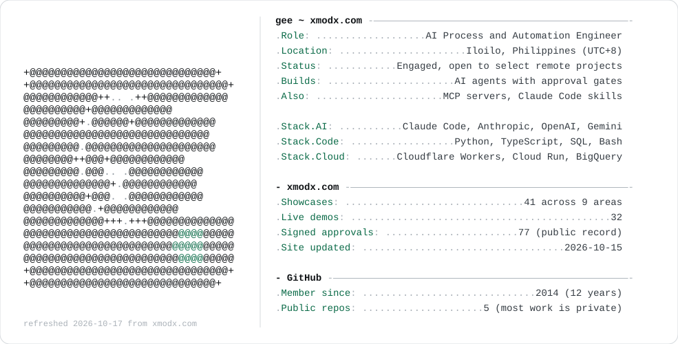

<a href="https://xmodx.com/">
  <picture>
    <source media="(prefers-color-scheme: dark)" srcset="./dark_mode.svg">
    
  </picture>
</a>

  <a href="https://xmodx.com/"><b>xmodx.com</b></a> ·
  <a href="https://xmodx.com/work/">Work</a> ·
  <a href="https://xmodx.com/about/">About</a> ·
  <a href="https://xmodx.com/ask/">Ask my AI about my work</a> ·
  <a href="https://xmodx.com/contact/">Contact</a>

I build AI automation that runs in production: agents that propose and wait for a human OK, AI receptionists and support agents, data platforms, MCP servers and Claude Code skills. Most of that code is private client work, so the case studies, live demos and a signed record of everything published live on [xmodx.com](https://xmodx.com/).

### Featured work

<!-- FEATURED:START (written by profile/build.py from the xmodx.com homepage) -->
- **[Governed AI action platform: architecture, data platform and advisory agents](https://xmodx.com/work/governed-ai-action-platform/)**  
  Took an online retailer from a map of recurring departmental work to one shared, governed AI platform: rate-limit-safe nightly ingest into one warehouse…
- **[Department AI agents with human approval gates](https://xmodx.com/work/department-ai-agents-with-approval-gates/)**  
  A family of chat-based department agents on shared, hardened foundations where the model does the routine work but every consequential action waits for an…
- **[Crew and equipment scheduling: from discovery to production](https://xmodx.com/work/crew-and-equipment-scheduling/)**  
  From interview- and workbook-based discovery and a priced build-versus-buy decision to a production scheduling platform whose tested conflict engine catches…
- **[Governed publishing pipeline and sanitized AI portfolio](https://xmodx.com/work/governed-publishing-pipeline/)**  
  This portfolio: private work reaches the public only through a machine-enforced chain of sanitized draft, deterministic privacy scan, explicit human approval…
- **[A secure, minimal AI agent: safe tool use and answers checked before they go out](https://xmodx.com/work/secure-minimal-agent/)**  
  A small, public, provider-agnostic reference agent that shows security and correctness disciplines in as little code as possible, with its safety claims pinned…
- **[Automated water test bench prototype with image classification](https://xmodx.com/work/water-quality-test-bench/)**  
  An inexpensive bench-top prototype that automates water sampling, chemistry readings and sample preparation for imaging, sorts the prepared sample with an…
<!-- FEATURED:END -->

The card and this list refresh daily from xmodx.com's public feed.
